# NeuroRoute

### MLP-Based Intelligent Routing & Multi-Optimizer Performance Analysis

**Learn routing decisions. Build valid tours. Explain optimizer behaviour with reproducible evidence.**

NeuroRoute is a planned intelligent routing system for the Travelling Salesperson Problem (TSP). It will use a Multilayer Perceptron (MLP) decision block and compare **SGD, SGD with Momentum, Adam, RMSprop, and AdaGrad** under controlled training conditions. The project connects classification performance with route quality, convergence, execution time, and algorithmic complexity.

> **Current status: planning and requirements documented.** No dataset, implementation, experiments, or measured results have been added to this repository. Unchecked items represent outstanding work, not completed features. A learned route is not guaranteed to be globally optimal.

| Project detail | Value |
| --- | --- |
| GitHub repository | [srimonishan/neuroroute-mlp](https://github.com/srimonishan/neuroroute-mlp) |
| Module | PUSL2099 - Algorithms for Machine Learning |
| Assessment | C1 group coursework; 50% of the module mark |
| Team | Bhagya, Zaid, Monishan, Sathish |
| Coursework marking | Implementation 50%; analysis and report quality 50% |
| Submission | DLE; deadline TBD in the supplied provisional guidelines |
| Planned stack | Python, NumPy, pandas, Matplotlib, Git/GitHub |

**GitHub description:**

> MLP-based intelligent routing for the Travelling Salesperson Problem, benchmarking SGD, Momentum, Adam, RMSprop, and AdaGrad through reproducible experiments, route-quality evaluation, and complexity analysis.

## Contents

- [Requirements and scope](#requirements-and-scope)
- [Problem formulation and proposed approach](#problem-formulation-and-proposed-approach)
- [Team responsibilities](#team-responsibilities)
- [Implementation checklist](#implementation-checklist)
- [Experiment and evaluation checklist](#experiment-and-evaluation-checklist)
- [Mathematics and complexity checklist](#mathematics-and-complexity-checklist)
- [Report and submission checklist](#report-and-submission-checklist)
- [Planned repository structure](#planned-repository-structure)
- [Reproducibility and results](#reproducibility-and-results)
- [Milestones and completion rules](#milestones-and-completion-rules)

## Requirements and scope

This plan uses the supplied **PUSL2099 Coursework Guidelines (Provisional)(1).pdf**, particularly printed pages 2-4 and the assessment rubric, together with the project concept image. The guidelines and concept image were reviewed during planning and are not currently included in this repository. The separate final project proposal and dataset are pending review. Lecturer requirements take precedence over the concept image and the recommendations below.

**Checklist labels:** **[Required]** means explicitly requested by the supplied coursework guidelines; **[Recommended]** means a proposed quality or correctness measure; **[Confirm]** means an unresolved decision or ambiguity. All boxes must be backed by evidence before being checked.

### Coursework requirements

- [ ] **[Required]** Implement an MLP classification network with an input layer matching the features, at least one nonlinear hidden layer, and an output layer for route decisions.
- [ ] **[Required]** Implement forward propagation and loss calculation, with a functioning training pipeline.
- [ ] **[Required]** Implement or configure all five optimizers: SGD, Momentum SGD, Adam, RMSprop, and AdaGrad.
- [ ] **[Required]** Compare optimizers using identical epoch counts, batch sizes, and initial weights.
- [ ] **[Required]** Record classification success rate, loss across epochs, and training time per epoch.
- [ ] **[Required]** Produce combined success-rate-versus-epochs and loss-versus-epochs charts.
- [ ] **[Required]** Explain the MLP mathematically, including loss and feature preprocessing.
- [ ] **[Required]** Analyze forward-pass, backward-pass, and optimizer-update complexity.
- [ ] **[Required]** Submit source code and an academic PDF report, including the required appendices.

The rubric's highest band emphasizes modular code, comprehensive benchmarking, and deep critical evaluation of convergence and trade-offs. It explicitly states that higher MLP accuracy does not automatically earn higher marks. This checklist supports that standard; it cannot guarantee a particular grade.

### Decisions requiring confirmation

- [ ] **[Confirm]** Review the final proposal, actual dataset, latest brief, deadline, and any report length or formatting rules.
- [ ] **[Confirm]** Resolve the guideline's screenshot wording: it requests “final sorted output” for a small input such as `n=100` and elapsed-time evidence such as `n=100,000`, although the primary task is routing. Ask the lecturer what output and what definition of `n` apply; retain the requirement until clarified.
- [ ] **[Confirm]** Confirm the expected balance of original implementation and library use. Task 2 permits implementing or configuring optimizers, while general guidance requires the core algorithm to be demonstrably the group's own work.
- [ ] **[Confirm]** Confirm the route classification target, label-generation method, and any required handling of variable city counts.

**Brief inconsistency:** deliverable Section B lists four optimizer names, but Task 2 explicitly requires five. This project will include Momentum SGD throughout implementation, charts, tables, and analysis.

## Problem formulation and proposed approach

### Routing objective

Given cities `V = {0, ..., n-1}` and travel costs `d(i,j)`, construct a tour that visits each city exactly once and returns to its starting city. For a permutation `π` of the cities, minimize:

```text
C(π) = sum(d(π[k], π[k+1]), k = 0 ... n-2) + d(π[n-1], π[0])
```

The final dataset specification must state whether costs are Euclidean or supplied, symmetric or asymmetric, and whether every pair of cities is connected. Do not silently replace supplied costs with Euclidean distances.

### Proposed MLP-to-tour design — pending dataset and proposal review

1. Represent a routing state using the current city, start city, visited-city mask, and relevant coordinate or distance features.
2. Train an MLP to classify the next city, using documented reference decisions as labels.
3. Mask visited cities during decoding, choose a valid next city, and repeat until all cities have been visited.
4. Return to the start, validate the tour, and calculate its total cost.
5. Compare classification decisions and completed tours separately.

A fixed-size output assumes a fixed number and consistent ordering of cities. Supporting other sizes requires an explicitly designed representation or separate models. Invalid-edge handling must also be defined if the graph is incomplete.

**Label quality matters:** exact solutions on small instances can supply optimal reference tours; a heuristic supplies heuristic labels. Imitating a heuristic does not establish optimality. Record tie-breaking rules for equally good decisions and tour direction/start equivalences where applicable.

**Generalization matters:** the brief says the given dataset contains one possible instance. Splitting states from one tour into train and test sets does not demonstrate performance on unseen routing instances. If synthetic instances are generated, document their distribution and split by original instance before producing related states or augmentations. If only one instance is used, state that limitation clearly.

```mermaid
flowchart LR
    A[Inspect data and define task] --> B[Split instances and prepare features]
    B --> C[Create reference decisions]
    C --> D[Build MLP]
    D --> E[Train with five optimizers]
    E --> F[Compare accuracy, loss and time]
    F --> G[Decode and validate tours]
    G --> H[Analyze route quality and complexity]
    H --> I[Report and reproducibility evidence]
```



## Team responsibilities

The allocations below follow the supplied concept image. Each member owns implementation evidence and the corresponding report explanation; integration and final review are shared.

| Member | Lead responsibility | Expected deliverables | Review partner |
| --- | --- | --- | --- |
| **1 — Bhagya** | Data and problem formulation | Dataset audit, preprocessing, features, labels, split manifest, formal TSP definition | Zaid |
| **2 — Zaid** | MLP model implementation | Modular network, activations, forward/backward propagation, loss, decoding integration, mathematical explanation | Monishan |
| **3 — Monishan** | Optimizer implementation | Five optimizers, update equations, controlled training runner, configurations, checkpoints and logs | Sathish |
| **4 — Sathish** | Evaluation, analysis and reporting | Metrics, comparative charts, route evaluation, complexity synthesis, integrated report and screenshot evidence | Bhagya |

### Member 1 — Bhagya

- [ ] Audit dataset origin, schema, city counts, units, missing values, duplicates, and invalid costs.
- [ ] Define input, output, objective, assumptions, constraints, and classification target.
- [ ] Design features and labels jointly with Zaid; document the reference solver or heuristic.
- [ ] Create reproducible training, validation, and test partitions without instance leakage.
- [ ] Fit preprocessing on training data only and save the fitted transformations.
- [ ] Deliver data documentation, generation/preprocessing scripts, and split identifiers.
- [ ] Write the problem-formulation and preprocessing report sections.

### Member 2 — Zaid

- [ ] Define input/output dimensions, hidden layers, activations, and initialization.
- [ ] Implement forward propagation, numerically stable classification loss, and backpropagation.
- [ ] Expose a consistent parameter/gradient interface for all optimizers.
- [ ] Implement route decoding with Bhagya and validate visit/return constraints.
- [ ] Check tensor shapes and gradients; demonstrate learning on a small controlled example.
- [ ] Write the MLP mathematical model and forward/backward complexity derivations.

### Member 3 — Monishan

- [ ] Implement or configure SGD, Momentum SGD, Adam, RMSprop, and AdaGrad.
- [ ] Document update equations, state variables, learning rates, and stability constants.
- [ ] Verify updates on a small hand-calculated example and reset optimizer state between runs.
- [ ] Start each optimizer from identical copied weights, using equal epochs and batch sizes.
- [ ] Save configurations, seeds, per-epoch metrics, checkpoint selection rules, and timings.
- [ ] Explain per-parameter update cost and additional state memory for every optimizer.
- [ ] Write the optimizer and controlled-experiment methodology sections.

### Member 4 — Sathish

- [ ] Agree metric definitions and logging format with the other members before experiments.
- [ ] Produce combined accuracy/loss curves, timing summaries, and five-optimizer comparison tables.
- [ ] Evaluate route validity and cost independently of classification accuracy.
- [ ] Relate observed convergence, stability, and execution time to optimizer update rules.
- [ ] Integrate complexity analysis, limitations, conclusions, and references.
- [ ] Assemble the PDF, all-source-code appendix, screenshots, and complete AI-use log.
- [ ] Coordinate an independent reproduction run and final submission audit.

### Shared ownership

- [ ] Record student IDs and agreed contributions before submission.
- [ ] Review another member's work and retain meaningful commit/review evidence.
- [ ] Ensure every member can explain the full pipeline and their own implementation.
- [ ] Record decisions and changed assumptions in a shared decision log.

## Implementation checklist

### Data and routing correctness

- [ ] **[Recommended]** Store original data separately from generated/processed data and record provenance and permitted use.
- [ ] **[Recommended]** Validate dimensions, finite values, city indexing, and cost-matrix assumptions.
- [ ] **[Recommended]** Version generation seeds, feature definitions, normalization parameters, and labels.
- [ ] **[Recommended]** Verify route length includes the final return edge.
- [ ] **[Recommended]** Check every output visits each city once, returns to the start, and uses valid edges.
- [ ] **[Recommended]** Handle repeated coordinates, tied decisions, and the documented minimum supported city count.

### MLP and optimizer correctness

- [ ] **[Required]** Complete input, nonlinear hidden, and classification output layers.
- [ ] **[Required]** Explain and implement forward computation and the selected loss.
- [ ] **[Recommended]** Use stable softmax/cross-entropy for the proposed multiclass next-city target.
- [ ] **[Recommended]** Compare analytic gradients with finite differences on a small network.
- [ ] **[Recommended]** Check optimizer update direction, accumulated state, and Adam bias correction.
- [ ] **[Recommended]** Verify training and evaluation modes, batch aggregation, and checkpoint restoration.
- [ ] **[Recommended]** Keep data preparation, model, optimizers, training, decoding, and evaluation modular.

## Experiment and evaluation checklist

### Fair comparison protocol

- [ ] **[Required]** Use identical epoch counts, batch sizes, and initial weights across all five optimizers.
- [ ] **[Recommended]** Also hold architecture, preprocessing, split, loss, and batch order constant within each comparison.
- [ ] **[Recommended]** Reset optimizer state and use the same hardware/software environment.
- [ ] **[Recommended]** Publish learning rates and all optimizer-specific parameters; identical learning rates are not inherently equally suitable.
- [ ] **[Recommended]** If tuning, give each optimizer an equal declared tuning budget, tune only on validation data, and separate tuned results from the controlled baseline.
- [ ] **[Recommended]** Repeat comparisons with multiple paired seeds and report run count, mean, and standard deviation.
- [ ] **[Recommended]** Define what epoch timing includes, excluding plotting and report generation consistently.
- [ ] **[Recommended]** Reserve the test partition for final evaluation; use validation for model selection.

### Metrics and evidence

| Metric | Purpose | Status |
| --- | --- | --- |
| Validation accuracy by epoch | Required combined success-rate curve | Pending |
| Final validation/test accuracy (%) | Required classification success rate; identify which split is reported | Pending |
| Training loss by epoch | Required convergence evidence | Pending |
| Training time per epoch | Required computational measurement | Pending |
| Valid-tour rate (%) | Recommended constraint correctness | Pending |
| Tour cost | Recommended end-to-end routing performance | Pending |
| Optimality gap (%) on small solvable cases | Recommended comparison with a proven optimum | Pending |
| Cost difference from a heuristic baseline | Recommended larger-instance comparison; not an optimality claim | Pending |

For positive known optimal cost `C*`, calculate `gap (%) = 100 × (C_model - C*) / C*`. Handle zero-cost instances separately. Classification accuracy measures agreement with reference labels; it does not establish tour validity or minimum tour cost.

- [ ] **[Required]** Plot all five optimizers together for accuracy versus epochs and loss versus epochs, with labeled axes and legends.
- [ ] **[Required]** Include accuracy tables and substantive convergence analysis.
- [ ] **[Recommended]** Preserve raw logs behind every table and figure.
- [ ] **[Recommended]** Include timing comparisons and uncertainty summaries across repeated runs.
- [ ] **[Recommended]** Compare against a simple routing baseline such as nearest neighbor.
- [ ] **[Recommended]** Validate small instances against an exact method within feasible limits.
- [ ] **[Recommended]** Explain failures, unstable runs, label limitations, and cases where classification accuracy and route quality disagree.

## Mathematics and complexity checklist

- [ ] **[Required]** Define layer equations, dimensions, weights, biases, activations, and output interpretation.
- [ ] **[Required]** Define the loss mathematically and justify its fit to the target.
- [ ] **[Required]** Explain backpropagation and how gradients reach trainable parameters.
- [ ] **[Required]** Present and explain update equations for all five optimizers.
- [ ] **[Required]** Derive forward and backward time complexity and per-parameter optimizer update complexity.
- [ ] **[Recommended]** Include model, activation, gradient, and optimizer-state memory costs to support the rubric's time/space analysis.
- [ ] **[Recommended]** Analyze feature/label generation, route decoding, and reference-solver costs separately from MLP training.
- [ ] **[Recommended]** Connect theoretical costs with measured timing without treating Big-O as an exact runtime prediction.

**Suggested notation for the final derivation:** let `B` be batch size, `E` epochs, `N` training records, `d_l` layer widths, `W = Σ(d_(l-1) × d_l)` dense weights, and `P` all trainable parameters including biases. A dense MLP forward/backward pass typically costs `O(BW)` each; the listed optimizers take `O(1)` work per parameter, or `O(P)` per update. Express epoch/training cost using the actual number of batches. Explain additional state arrays rather than suggesting that all `O(P)` optimizers have identical memory or timing. Validate these assumptions against the final implementation.

## Report and submission checklist

### Suggested academic report order

- [ ] **[Recommended]** Title page: project, module, team names/IDs, and submission details.
- [ ] **[Recommended]** Abstract: problem, approach, experiment design, measured findings, and main limitation.
- [ ] **[Required]** Problem formulation: inputs, outputs, constraints, and objective.
- [ ] **[Required]** Algorithm justification: why the chosen MLP formulation and methods fit the task.
- [ ] **[Required]** System formulation: dataset preprocessing, feature design, network mathematics, and loss.
- [ ] **[Required]** Optimizer comparative evaluation: methodology, charts, tables, and convergence discussion.
- [ ] **[Required]** Algorithmic complexity: forward pass, backpropagation, and all optimizer updates.
- [ ] **[Recommended]** Critical discussion: trade-offs, generalization, routing quality, limitations, and threats to validity.
- [ ] **[Recommended]** Conclusion tied to measured evidence and justified future work.
- [ ] **[Required]** Consistent references and attribution for external text, code, data, and diagrams.
- [ ] **[Required]** Appendix with all implemented source code inline; a repository link alone is insufficient.
- [ ] **[Required]** Screenshot appendix showing correctness and runtime/environment evidence; resolve the brief's sorting/input-size wording with the lecturer.
- [ ] **[Required]** AI-use appendix containing every relevant prompt and its full received output when AI tools are used.
- [ ] **[Recommended]** Contribution table with responsibilities and supporting evidence.

### Evidence and academic integrity

- [ ] **[Required]** Ensure core work is demonstrably the team's own and external material is acknowledged.
- [ ] **[Required]** Keep complete AI prompts and outputs, including AI-generated explanations used in the project; summaries alone do not satisfy the stated log requirement.
- [ ] **[Recommended]** Preserve this planning conversation and the earlier conversation used to create the concept image for the AI-use record.
- [ ] **[Recommended]** Annotate AI-assisted work with verification performed and corrections made by the team.
- [ ] **[Recommended]** Capture readable screenshots with input, command, output, elapsed time, and matching run identifiers.
- [ ] **[Recommended]** Check that report numbers match exported logs and that all five optimizers appear throughout.

### Final submission gate

- [ ] **[Required]** Recheck the latest lecturer instructions, deadline, and required submission formats.
- [ ] **[Recommended]** Run from a clean environment using the documented commands.
- [ ] **[Recommended]** Verify data availability or deterministic generation instructions.
- [ ] **[Recommended]** Inspect the final PDF for clipped figures, unreadable source code, missing captions, and broken references.
- [ ] **[Recommended]** Confirm every checked item has reviewable evidence and no placeholders remain in the final report.
- [ ] **[Required]** Submit source code and PDF through the specified DLE process before the confirmed deadline.
- [ ] **[Recommended]** Retain the submitted version and submission receipt.

## Planned repository structure

The following is a proposed layout, not a list of files already implemented.

```text
neuroroute-mlp/
├── README.md
├── requirements.txt             # Tested, pinned dependencies
├── .gitignore
├── configs/                     # Architecture, optimizer and run settings
├── data/
│   ├── README.md                # Provenance, schema and acquisition instructions
│   ├── raw/
│   └── processed/
├── src/
│   ├── data/                    # Validation, generation, features, labels, splits
│   ├── models/                  # MLP, activations, losses and gradients
│   ├── optimizers/              # SGD, Momentum, Adam, RMSprop and AdaGrad
│   ├── routing/                 # Decoding, constraints and routing baselines
│   ├── training/                # Controlled training and checkpointing
│   └── evaluation/              # Metrics, comparisons and plotting
├── tests/                       # Gradients, updates, splits and tour correctness
├── experiments/                 # Run manifests and raw metric logs
├── outputs/
│   ├── figures/
│   ├── tables/
│   └── screenshots/
├── docs/
│   ├── decisions.md
│   ├── contributions.md
│   └── ai-use-log/              # Complete prompts/outputs and verification notes
└── report/                      # Report source and final PDF
```

## Reproducibility and results

**Run instructions are pending implementation.** No executable entry points or dependency manifest exist yet; do not treat the planned layout as runnable software.

- [ ] Record the tested Python version, operating system, hardware, and dependency versions.
- [ ] Add exact installation and data-preparation commands after validating them.
- [ ] Add commands to train each optimizer and reproduce the complete comparison.
- [ ] Add commands to evaluate held-out instances, decode tours, and regenerate figures/tables.
- [ ] Document seeds, saved configurations, checkpoint policy, and output locations.
- [ ] Have a different team member reproduce a representative run from the instructions.

### Results table — populate only from recorded experiments

| Optimizer | Test accuracy (%) | Final training loss | Mean epoch time (s) | Valid tours (%) | Mean tour cost |
| --- | --- | --- | --- | --- | --- |
| SGD | Pending | Pending | Pending | Pending | Pending |
| SGD with Momentum | Pending | Pending | Pending | Pending | Pending |
| Adam | Pending | Pending | Pending | Pending | Pending |
| RMSprop | Pending | Pending | Pending | Pending | Pending |
| AdaGrad | Pending | Pending | Pending | Pending | Pending |

State run count, variability, evaluation split, city count, cost units, and checkpoint selection alongside the completed table. Do not select a “best optimizer” until the evidence supports a clearly defined criterion.

## Milestones and completion rules

| Gate | Completion evidence | Lead |
| --- | --- | --- |
| 1. Scope agreed | Reviewed proposal/dataset; resolved lecturer questions; defined target and constraints | Bhagya + team |
| 2. Data ready | Reproducible features/labels, training-only preprocessing, leakage-safe splits | Bhagya |
| 3. MLP verified | Forward/loss/backward checks and a working small learning example | Zaid |
| 4. Optimizers integrated | Five verified update rules and controlled run configurations | Monishan |
| 5. Benchmarks complete | Raw logs, combined curves, route metrics, timing and repeat-run summaries | Sathish + team |
| 6. Analysis complete | Mathematical justification, complexity derivations and evidence-based discussion | All members |
| 7. Submission ready | Reproduction check, complete PDF appendices, AI log and final audit | Sathish + team |

**Definition of done:** check an item only when the relevant code, data, experiment artifact, report section, or written clarification exists and another team member has reviewed it. Add evidence paths or commit references beside completed items. Update this plan when the final proposal or lecturer guidance changes.
